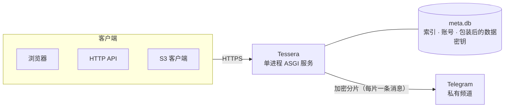

<div align="center">


# Tessera

**把 Telegram 私有频道变成你的加密网盘。**

自托管 · 服务端加密 · 网页端 + HTTP API + S3 兼容网关 · 离线下载

[](https://github.com/yangshoulai/tgdrive/tags)
[](https://github.com/yangshoulai/tgdrive/pkgs/container/tgdrive)
[](pyproject.toml)
[](web/package.json)
[](#客户端接入)

[**在线文档**](https://tessera.yangshoulai.xyz/docs/) · [**快速开始**](#快速开始) · [**功能特性**](#功能特性) · [**安全模型**](#安全模型与限制)

<br>

<picture>
  <source media="(prefers-color-scheme: dark)" srcset="docs/screenshots/grid-dark.png">
  
</picture>

</div>

## 简介

Tessera 在服务端把文件加密、切成分片，通过 Telegram Bot API 保存到**你自己的私有频道**。文件索引和密钥只保存在本地的 SQLite 数据库中，Telegram 只能看到密文。

在此之上，它提供一个完整的网盘：文件管理、在线预览、公开分享、私密空间、离线下载，以及供脚本和工具使用的 HTTP API 与 S3 兼容网关。整个服务是一个 Python 进程加一个 SQLite 文件，一条 `docker compose up` 即可运行，面向个人与小团队（数名用户）自托管。

> 作者自用的部署实例位于 **<https://tessera.yangshoulai.xyz>**，不开放注册；其中的[文档站](https://tessera.yangshoulai.xyz/docs/)对所有人公开，可以先在那里了解完整的使用说明与 API。

<table>
<tr>
<td width="33%" valign="top">

### 🔐 服务端加密

Argon2id 派生主密钥，每个文件独立数据密钥，AES-256-GCM 分帧加密。Telegram 只看到密文分片。

</td>
<td width="33%" valign="top">

### 🗂️ 完整的网盘体验

上传、整理、搜索、类型筛选，图片 / 音视频 / Markdown / 代码在线预览，深色模式与手机适配。

</td>
<td width="33%" valign="top">

### 🔗 灵活的分享

文件和文件夹都能分享，可设密码与有效期；访客打包下载，登录用户一键保存到自己的空间。

</td>
</tr>
<tr>
<td valign="top">

### 🧩 S3 兼容网关

SigV4 签名与预签名 URL，rclone、AWS CLI、boto3 开箱即用；访问密钥可按前缀授予只读或读写。

</td>
<td valign="top">

### ⬇️ 离线下载

服务器代为下载直链与 curl 命令，可选 M3U8、X、YouTube 解析；配套浏览器脚本一键发送。

</td>
<td valign="top">

### 🛡️ 为自托管而设计

多用户与配额、私密空间、通行密钥登录、审计日志、加密备份，单个容器即可运行。

</td>
</tr>
</table>

## 截图

<table>
<tr>
<td width="50%"><p align="center"><sub>文件列表：类型快速筛选、公开标记、列排序</sub></p></td>
<td width="50%"><p align="center"><sub>图片查看器：缩放、旋转、同目录胶片条</sub></p></td>
</tr>
<tr>
<td><p align="center"><sub>音乐播放器：播放列表、播放模式、同名 LRC 歌词</sub></p></td>
<td><p align="center"><sub>Markdown 与代码预览：渲染 / 源码切换，不执行原始 HTML</sub></p></td>
</tr>
<tr>
<td><p align="center"><sub>文件夹分享页：访客浏览、打包下载、保存到自己的 Tessera</sub></p></td>
<td><p align="center"><sub>管理控制台：用户与配额、存储通道、审计、维护</sub></p></td>
</tr>
<tr>
<td><p align="center"><sub>内置文档站：使用指南、API 参考、S3 兼容性，⌘K 搜索</sub></p></td>
<td><p align="center"><sub>登录：账号密码或通行密钥（Passkey）</sub></p></td>
</tr>
</table>

<p align="center"><br><sub>手机端</sub></p>

<sub>截图来自使用演示数据的本地实例；文档站截图来自线上实例。</sub>

## 功能特性

<details open>
<summary><b>存储与加密</b></summary>

- 每个文件有独立的数据密钥，由加密口令经 **Argon2id** 派生的主密钥包装；内容以 16 MiB 分片、64 KiB 帧做 **AES-256-GCM** 加密。
- 存储后端为 Telegram 私有频道，支持多个 Bot 轮换与故障冷却；未配置 Bot 时使用本地目录，便于开发测试。
- 内容相同的文件共享同一份加密数据：**秒传**、服务端复制和保存他人分享都不重复上传。
- 读取时按需下载并解密对应分片，支持 HTTP Range 与视频拖动。

</details>

<details open>
<summary><b>网页端</b></summary>

- **文件管理**：大文件分块并行上传与断点续传，移动、重命名、回收站、配额、按文件名搜索，列表 / 网格视图，按类型快速筛选，键盘快捷键。
- **在线预览**：图片查看器，音视频播放（播放列表、字幕、歌词），文本、代码与 Markdown；缩略图在浏览器中生成并加密保存。
- **公开分享**：文件和文件夹均可分享，支持密码、有效期和下载次数统计；访客可打包下载 ZIP，登录用户可把分享保存到自己的空间。
- **私密空间**：需要再次验证（登录密码或通行密钥）才能访问的独立目录，闲置自动锁定，独立回收站。
- **账号与管理**：邮箱登录，头像与昵称，通行密钥登录；管理员控制台管理用户、配额、存储通道、访问密钥、审计日志、备份与维护任务。
- **内置文档站**：`/docs/` 提供使用说明、API 与 S3 兼容性文档；管理员文档仅对管理员会话下发。
- 深色模式（跟随系统或手动切换）与手机端适配。

</details>

<details open>
<summary><b>程序访问</b></summary>

- `/api/v1`：访问密钥认证的 HTTP API，覆盖列表、搜索、上传、下载、移动、复制、删除、公开分享、秒传与离线下载。
- **S3 兼容网关**：SigV4 签名与预签名 URL，可直接使用 rclone、AWS CLI、boto3 等工具。
- 访问密钥可按存储桶与路径前缀授予只读或读写权限，所属用户被禁用时自动失效。

</details>

<details open>
<summary><b>离线下载</b></summary>

- 服务器代为下载 HTTP/HTTPS 直链，或解析浏览器复制的 curl / wget 命令；支持停止、继续与自动重试。
- 可选组件：M3U8（需 FFmpeg）、X 单条帖子的图片与视频、YouTube 单视频与 Shorts（需平台镜像）。
- 配套 [Tampermonkey 脚本](#浏览器脚本)，在任意网页上一键复制资源的 curl 命令或批量发送到离线下载。

</details>

## 工作原理



| 层级 | 做法 |
| --- | --- |
| 主密钥 | 加密口令经 Argon2id 派生，只存在于进程内存中 |
| 数据密钥 | 每个文件一把，用主密钥包装后存入 `meta.db`；更换口令只需重新包装，不必重新加密文件 |
| 分片加密 | 数据密钥经 HKDF 派生分片密钥，内容按 64 KiB 帧做 AES-256-GCM 认证加密 |
| 分片大小 | 16 MiB，满足 Telegram 云端 Bot API 的文件下载上限（20 MB） |

## 安全模型与限制

部署前请了解以下事实：

- **加密口令无法找回。** 所有数据密钥都由它保护，遗失后已存储的文件无法解密。
- **重启后需要人工解锁。** 主密钥只存在于内存中。服务启动后处于锁定状态，普通用户无法登录，公开链接返回 503，直到管理员登录并输入加密口令。
- **这不是端到端加密。** 加密在服务端完成，全系统共用一把主密钥；能控制服务器或管理员账号的人在技术上可以读取所有用户的文件。它防护的是 Telegram 侧和存储介质上的数据泄露。
- **`meta.db` 是唯一的索引。** 丢失数据库后，频道中的分片将无法还原为文件。请定期[备份](#备份与恢复)。
- **只支持单进程运行。** 会话、登录限流和 Telegram 客户端池保存在进程内存中，不要使用多个 worker 或让多个实例共享数据目录。
- **依赖 Telegram 云端 Bot API。** 上传下载速度、限流和可用性受 Telegram 约束，请自行评估是否符合 Telegram 的服务条款和你的使用场景。

## 快速开始

需要 Docker 与 Docker Compose。

**本机体验（HTTP）**

```bash
git clone https://github.com/yangshoulai/tgdrive.git
cd tgdrive
docker compose -f docker-compose.yml -f docker-compose.dev.yml up -d --build
```

打开 <http://127.0.0.1:8000/>，按页面提示设置加密口令并创建管理员账号。`docker-compose.dev.yml` 只做一件事：允许在 HTTP 下使用 Cookie（`TGDRIVE_INSECURE_COOKIES=1`），不要用于生产环境。

**生产部署**

使用 GitHub Container Registry 上的镜像，删除 `docker-compose.yml` 中的 `build` 部分后执行：

```bash
docker compose pull
docker compose up -d
```

请在反向代理后启用 HTTPS，并在控制台「系统设置」中填写公开访问地址与 S3 Endpoint（也可用启动参数设置）。通行密钥要求站点使用 HTTPS 域名。容器监听 `8000` 端口，数据目录为 `/data`，`/healthz` 可用于健康检查。

> [!NOTE]
> 容器以 root 启动，入口脚本在数据目录属主不是 uid 10001 时修正属主，然后降权运行服务，因此命名卷和 `./data:/data` 这类宿主机目录都可直接使用。如果在 Compose 中用 `user:` 指定了其他用户，需要自行保证 `/data` 可写。

### 镜像

镜像地址为 `ghcr.io/yangshoulai/tgdrive`，每次发布版本时由 GitHub Actions 构建三个变体：

| 标签 | 内容 | 适用场景 |
| --- | --- | --- |
| `1`、`1.0`、`1.0.0`、`latest` | 基础镜像 | 文件存储、分享、直链离线下载 |
| `1-ffmpeg`、`1.0.0-ffmpeg`、`latest-ffmpeg` | 基础镜像 + FFmpeg | 需要下载 M3U8 |
| `1-platform`、`1.0.0-platform`、`latest-platform` | FFmpeg + yt-dlp、gallery-dl、Node.js | 需要下载 X / YouTube 媒体 |

版本号遵循语义化版本：同一主版本内（`1.x.y`）的升级保持数据库、`/api/v1`、S3 网关兼容，启动时自动迁移数据库。生产环境建议固定主版本标签（如 `1`），这样能自动获得修复又不会跨越不兼容的升级；每个版本的变化见 [CHANGELOG.md](CHANGELOG.md)，升级前建议先做一次加密备份。

可选功能还需要在控制台「系统设置 → 下载与资源」中启用。本地构建对应变体：`docker build --build-arg INSTALL_FFMPEG=1 .` 或 `docker build --target platform .`。

### 连接 Telegram

1. 通过 [@BotFather](https://t.me/BotFather) 创建 Bot，获得 token。
2. 创建一个私有频道，把 Bot 添加为可以发布消息的管理员。
3. 在控制台「存储通道」中添加 Bot token 与频道，系统会自动检查 token、频道访问和发布权限。

启用存储通道后，新写入的文件保存到频道；Bot token 加密后保存在数据库中，接口不会返回明文。可以添加多个 Bot 分担上传和下载。

## 配置

启动参数与对应的环境变量等效；控制台中的系统设置优先于启动参数。

| 参数 | 环境变量 | 说明 |
| --- | --- | --- |
| `--data-dir` | `TGDRIVE_DATA_DIR` | 数据目录（元数据库、本地分片、备份），默认 `./data` |
| `--host` | `TGDRIVE_HOST` | 监听地址，默认 `127.0.0.1`（镜像中为 `0.0.0.0`） |
| `--port` | `TGDRIVE_PORT` | 监听端口，默认 `8000` |
| `--public-url` | `TGDRIVE_PUBLIC_URL` | 对外访问地址，用于分享链接、API 与文档示例 |
| `--s3-endpoint` | `TGDRIVE_S3_ENDPOINT` | S3 客户端使用的完整 Endpoint |
| `--trusted-proxies` | `TGDRIVE_TRUSTED_PROXIES` | 信任其 `X-Forwarded-For` / `X-Forwarded-Proto` 的代理 IP 或网段，逗号分隔 |
| `--insecure-cookies` | `TGDRIVE_INSECURE_COOKIES=1` | 允许 HTTP 下的会话 Cookie，仅限本地开发 |

<details>
<summary>更多参数</summary>

| 参数 | 环境变量 | 说明 |
| --- | --- | --- |
| `--static-dir` | `TGDRIVE_STATIC_DIR` | 前端构建产物目录，镜像已内置 |
| `--s3-host` | `TGDRIVE_S3_HOST` | 未设置 S3 Endpoint 时用于识别 S3 请求的主机名 |
| `--audit-retention-days` | `TGDRIVE_AUDIT_RETENTION_DAYS` | 在线审计日志保留天数，过期记录加密归档；默认 `0` 为永久保留 |
| `--resource-mode` | `TGDRIVE_RESOURCE_MODE` | 离线下载资源预设：`auto`、`low`、`standard`、`custom` |
| `--offline-proxy` | `TGDRIVE_OFFLINE_PROXY` | 离线下载的出站代理（`http://` 或 `socks5://`） |

离线下载的其他参数（并发、限速、磁盘保留空间、M3U8 / X / YouTube 开关、YouTube 清晰度上限等）见 `tgdrive --help` 与 `docker-compose.yml` 中的注释。

</details>

> [!WARNING]
> `--trusted-proxies` 只应填写实际的反向代理地址；在不受控的网络中使用 `*` 会让客户端可以伪造来源 IP。

## 客户端接入

在网页「访问密钥」页面创建密钥（Secret 只显示一次），每个用户的存储桶名为 `user-<编号>`。

```bash
# HTTP API
curl -H "Authorization: Bearer <AccessKeyId>:<Secret>" "https://drive.example.com/api/v1/list?prefix=docs/"

# S3（路径风格）
aws s3 ls s3://user-2/ --endpoint-url https://s3.example.com
```

| S3 操作 | 支持情况 |
| --- | --- |
| ListBuckets、HeadBucket、GetBucketLocation | ✅ |
| ListObjectsV2、GetObject（含 Range）、HeadObject | ✅ |
| PutObject（含 aws-chunked）、DeleteObject、DeleteObjects | ✅ |
| CopyObject、分段上传、UploadPartCopy | ✅ |
| 预签名 URL | ✅ |
| 版本控制、ACL、生命周期、对象锁、POST 表单上传 | ❌ |

完整的接口说明、示例和限制见[文档站](https://tessera.yangshoulai.xyz/docs/)。

## 离线下载

在网页侧栏「下载任务」中粘贴文件直链，或浏览器开发者工具中复制的 bash 格式 curl / wget 命令，解析后选择文件与保存目录，由服务器下载并加密存储。

- 所有出站请求都会校验并固定公网地址，不访问本机、内网或云元数据地址；可配置出站代理。
- 来源地址、请求头和 Cookie 加密保存，不出现在任务列表和审计日志中。
- 网络中断、超时和 HTTP 408 / 425 / 429 / 5xx 自动重试；直链按 16 MiB 分段续传。
- M3U8 仅支持已结束的 H.264 / AAC 点播（含普通 AES-128），不支持直播、DRM 和 SAMPLE-AES；只封装，不转码。
- X 支持单条帖子中的原图与视频；YouTube 支持单视频与 Shorts 中可用的 H.264 / AAC 格式（默认最高 2160p），可只保存 M4A 音轨。不支持直播、频道或播放列表批量下载、DRM。解析在服务器本地运行，不依赖第三方解析网站。
- 默认镜像不包含 FFmpeg 和平台解析器，请按需选择[镜像变体](#镜像)。小内存服务器建议使用低资源模式。

设计与排障说明：[离线下载](docs/offline-downloads.md) · [平台下载](docs/platform-downloads.md) · [兼容性排查](docs/offline-reliability.md)

## 浏览器脚本

[`userscripts/tessera-grabber.user.js`](userscripts/tessera-grabber.user.js) 是一个 Tampermonkey 用户脚本，在 X 帖子、YouTube 播放页和普通网页上列出已加载的视频、音频、M3U8、常见文件和大图：

- 每行有复制链接、复制 curl 命令、在新标签页打开、**本地下载**、**服务器下载**五个按钮，勾选多项后底部同样有「本地下载」「服务器下载」；
- 两种保存方式点开后是同一个确认页：选择保存位置（可就地新建文件夹，也可选私密空间）、逐项修改保存文件名，可以移除不要的项；
  - 服务器下载：由 Tessera 服务器下载，打开确认页时先解析，每个文件一行，视频可在行内下拉选择清晰度；适合大文件、M3U8 和 X／YouTube 视频；
  - 本地下载：由当前浏览器读取文件后上传，适合服务器被拒绝（防盗链、登录、人机验证）的图片或文件直链；
- 进度页显示每项的下载、上传或服务器任务进度，支持停止、改名和重试，已保存的资源自动跳过；服务器下载失败后可一键「失败项改用本地下载」；
- 选择私密空间时会转交 Tessera 页面解锁确认，密码不经过原网页和脚本；
- 悬浮按钮可拖动，可以按网站选择显示或隐藏。

安装：在 Tampermonkey 中新建脚本并粘贴文件内容，然后在脚本设置中填写 Tessera 地址和访问密钥（需要读写权限）。脚本只通过访问密钥调用 `/api/v1` 接口。服务器下载提交的 Cookie 只交给你配置的服务器；本地下载只向 Tessera 发送文件数据，不转发来源网站的 Cookie。

本地下载单文件最多 64 MiB，一次最多 50 项，逐项下载并上传；仅支持 HTTP(S) 文件直链，M3U8／DASH 及平台视频仍需服务器解析。默认保存文件名取自链接，可逐项编辑，未填写扩展名时按内容类型补上；文件名不能包含路径、控制字符或保留名称，最多 220 字节，同一批次不能重名。按填写的名称保存，同名时保留已有文件并提示改名后重试。

本地下载也可以保存到私密空间：访问密钥不能写入私密空间，点「开始上传」时脚本会打开一个 Tessera 标签页，把下载好的文件通过 `postMessage` 交给它（只认 Tessera 的地址和本次随机标识），你在那里解锁、在上传对话框确认后才通过网页会话上传。少数网站禁止跨站窗口通信，这时请手动保存后上传。

传输期间请保持原网页打开，关闭面板可继续，刷新或关闭网页会中断。图片优先尝试浏览器缓存；跨域、CSP 阻止读取或网页请求返回 403 时，再尝试一次带来源 Cookie、Referer 与图片 Accept 头的 Tampermonkey 请求（User-Agent 保持浏览器自带的值）。

遇到 Cloudflare 人机验证（403 且带 `cf-mitigated: challenge`）时，后台请求无论怎样都无法通过，条目会显示「打开验证」：点它在新标签页打开资源，完成验证后回到面板点重试，扩展请求会带上新的验证 Cookie。注意 Cloudflare 的验证 Cookie 通常绑定浏览器与出口 IP，所以服务器下载依旧会被拦截，这类资源请使用本地下载。登录或验证页面仍拒绝上传；如果两种请求都被拦截，错误会显示各阶段的状态。直接打开原图成功不保证脚本能读取，此时可手动保存原图再上传。

## 备份与恢复

控制台「维护与备份」可以创建加密备份，文件保存在数据目录的 `backups/` 下（`*.tgdbak`）。备份包含元数据库（文件索引、账号、被包装的数据密钥等），不包含分片本身——分片保存在 Telegram 频道或本地分片目录中。请把备份文件复制到服务器以外的位置，并保存好备份时的加密口令。

恢复前先停止服务：

```bash
tgdrive restore /path/to/tgdrive-20261014-120000.tgdbak --data-dir /var/lib/tgdrive
```

命令会提示输入备份时的口令，原数据库保留为 `meta.db.before-restore-*`。加密归档的审计日志可用 `tgdrive audit-export <归档文件> --output audit.jsonl` 导出。

## 本地开发

需要 Python 3.12+ 与 Node.js 20+。

```bash
python3.12 -m venv .venv
.venv/bin/pip install -e ".[dev]"
(cd web && npm ci)

# 构建前端并启动服务（单进程同时提供 API 和网页）
(cd web && node build-apps.mjs)
.venv/bin/tgdrive --data-dir /tmp/tgdrive-dev --port 8000 --static-dir web/dist --insecure-cookies

# 全部检查：ruff、单元测试、TypeScript 类型检查、前端构建
make check PYTHON=.venv/bin/python
```

前端没有开发服务器：修改后重新运行 `node build-apps.mjs` 并刷新页面即可，无需重启后端。未配置 Bot 时文件保存在数据目录中的本地分片目录。

发布新版本：同时更新 `pyproject.toml` 与 `web/package.json` 的版本号、在 `CHANGELOG.md` 写明变化，然后推送 `v<版本号>` 标签（CI 会校验标签与 `pyproject.toml` 一致）。

更多约定见 [`AGENTS.md`](AGENTS.md)（代码约定）、[`DESIGN.md`](DESIGN.md)（视觉规范）、[`UX-CONTRACT.md`](UX-CONTRACT.md)（交互与路由）和 [`docs/architecture-v2.md`](docs/architecture-v2.md)（架构设计）。

<details>
<summary><b>项目结构</b></summary>

```text
src/tgdrive/            Python 后端：ASGI 路由、对象服务、加密、S3 网关、Telegram 适配、离线下载
web/src/                React 18 + TypeScript 前端：用户端、管理控制台、文档站
web/build-apps.mjs      前端打包脚本（产物位于 web/dist，不纳入版本库）
userscripts/            Tampermonkey 资源抓取脚本
tests/                  unittest 回归测试
docs/                   架构设计、离线下载说明与 README 截图
Dockerfile              多阶段镜像（基础 / FFmpeg / 平台）
docker-compose*.yml     部署与本地开发配置
.github/workflows/      推送 v* 标签时构建并发布镜像
```

</details>

## 许可证

仓库目前没有附带开源许可证文件。在添加许可证之前，代码默认保留所有权利。
