<div align="center">


# Tessera

**千片成璧，唯你可合。**

把 Telegram 私有频道变成你的加密网盘。

文件管理与沉浸预览 · AI 文件助手 · 离线下载与网页收集 · HTTP API / S3

[](https://github.com/yangshoulai/tgdrive/releases)
[](https://github.com/yangshoulai/tgdrive/actions/workflows/docker.yml)
[](LICENSE)

[功能特点](#功能特点) · [界面预览](#界面预览) · [快速开始](#快速开始) · [文件助手](#文件助手) · [网页资源抓取](#网页资源抓取) · [使用文档](#使用文档)

</div>

<a id="简介"></a>

Tessera 是面向个人与小团队的**自托管文件空间**。文件在服务器上加密、切成分片，经 Telegram Bot API 保存到你自己的私有频道；文件索引与加密后的数据密钥保存在本地 SQLite 中。

日常上传、整理、预览和分享都在网页里完成。文件助手协助查找与批量整理，离线下载和资源抓取脚本把网页内容收进网盘；已有的脚本、rclone、AWS CLI 等工具可以通过 HTTP API 或 S3 兼容网关接入。

**一个容器、单个服务进程，无需额外部署数据库或消息队列。** 未配置 Telegram 时可先使用本地存储体验；模型服务、FFmpeg 与平台下载组件按需启用。

<picture>
  <source media="(prefers-color-scheme: dark)" srcset="docs/screenshots/grid-dark.png">
  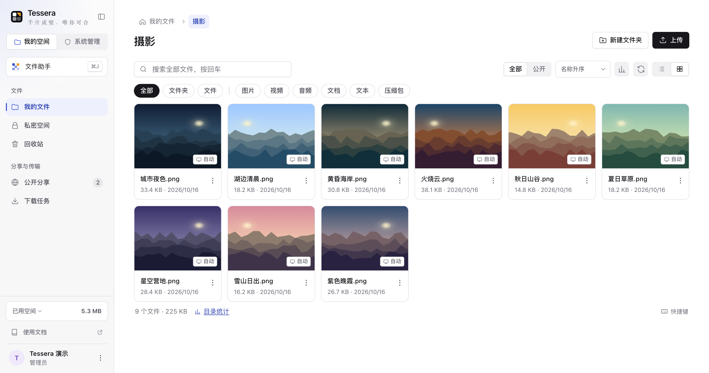
</picture>

<a id="功能特性"></a>

## 功能特点

| 能力 | 可以做什么 |
| --- | --- |
| **文件管理** | 分块并行上传、断点续传、秒传；搜索、组合筛选、排序、拖放移动、打包下载、批量操作与回收站。大目录连续浏览，列表和网格按需切换。 |
| **沉浸预览** | 图片缩放、旋转与胶片条；音视频播放、字幕、歌词和播放列表；Markdown、代码与 PDF 阅读。预览可调整大小、固定、最小化，音视频跨页继续播放。 |
| **AI 文件助手** | 用对话查询文件、统计用量、查重、总结文本，生成改名、移动、归类与下载方案；限定访问范围，默认确认后修改。支持识图模型与附件；解锁私密空间后也能处理私密文件。 |
| **分享与私密** | 文件、文件夹分享，访问密码、有效期与下载统计；访客可筛选、排序、打包下载，登录后保存到自己的空间。私密空间额外验证、闲置锁定，使用独立回收站。 |
| **离线下载** | 服务器下载直链、curl / wget 请求、M3U8、X 与 YouTube 媒体，关闭网页后继续；可搜索任务、停止、继续和更新过期参数。 |
| **网页资源收集** | 配套浏览器脚本嗅探图片、音视频与文件，批量交给服务器，或由浏览器读取后上传；支持桌面脚本管理器及 iOS Safari。 |
| **加密本机缓存** | 自动缓存预览读过的内容与缩略图，也可完整缓存任意类型文件；按设备设置容量，完整、部分缓存均可清除。管理员允许后，私密文件可逐台设备开启缓存。 |
| **账号与接入** | 邮箱验证码或一次性邀请码注册，注册开关与默认配额可配置；多用户、昵称头像与通行密钥，按目录授权访问密钥，同一套密钥接入 HTTP API 与 S3。控制台提供存储通道、用量、审计、备份与维护。 |

界面支持浅色、深色与跟随系统，适配电脑和手机；桌面侧栏可收起成图标栏。界面与预览引擎资源随应用分发，无需外部字体或 CDN。

<a id="截图"></a>

## 界面预览

<table>
<tr>
<td width="50%">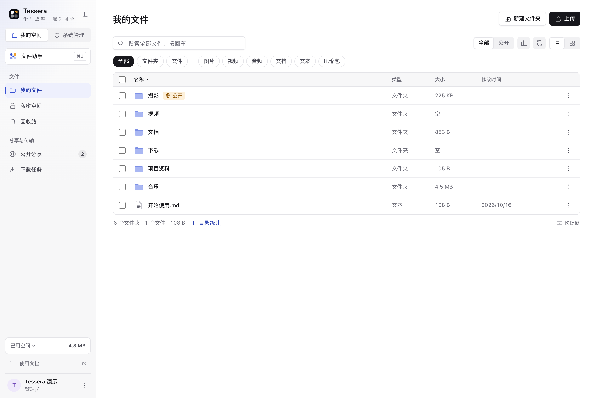<p align="center"><sub>文件管理：列表、组合筛选、排序与批量操作</sub></p></td>
<td width="50%">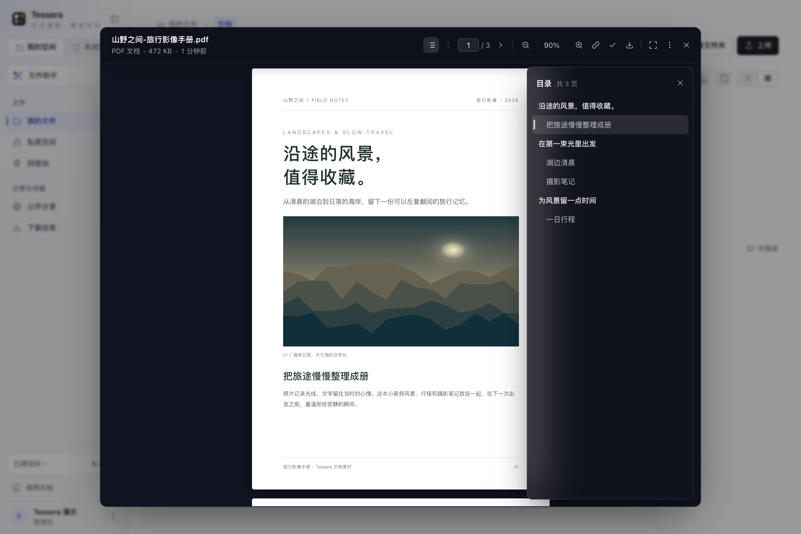<p align="center"><sub>PDF：连续阅读、缩放、跳页、目录与文字选择</sub></p></td>
</tr>
<tr>
<td>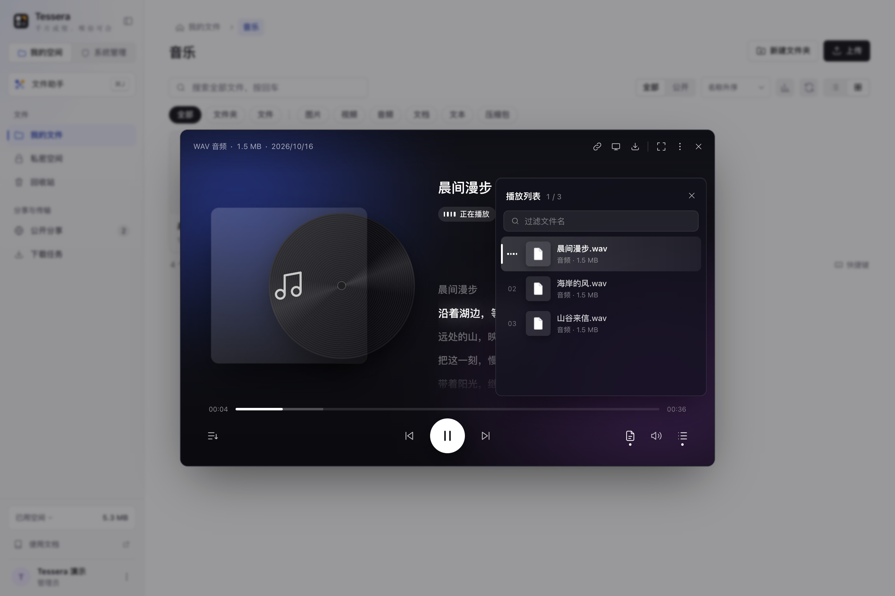<p align="center"><sub>音乐：歌词、播放列表与跨页播放</sub></p></td>
<td>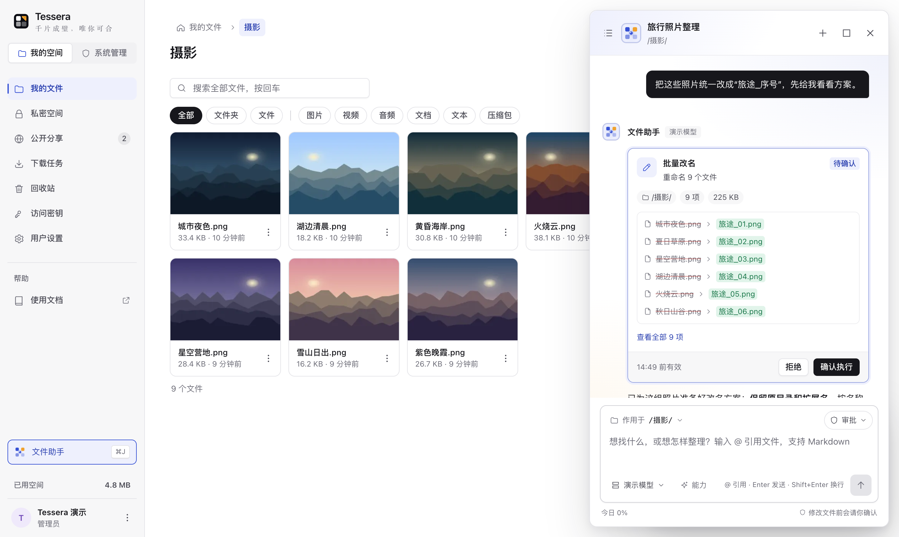<p align="center"><sub>文件助手：访问范围、执行过程与待确认方案</sub></p></td>
</tr>
<tr>
<td>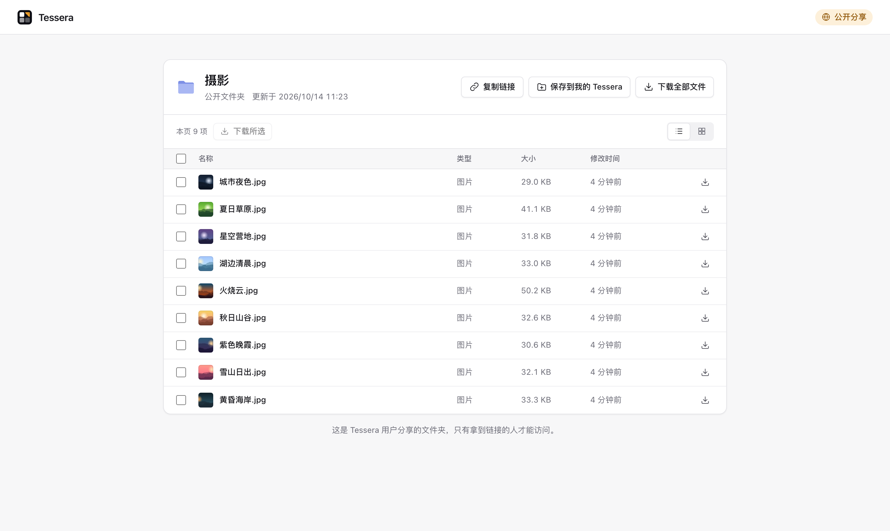<p align="center"><sub>文件夹分享：筛选、排序、下载与保存</sub></p></td>
<td>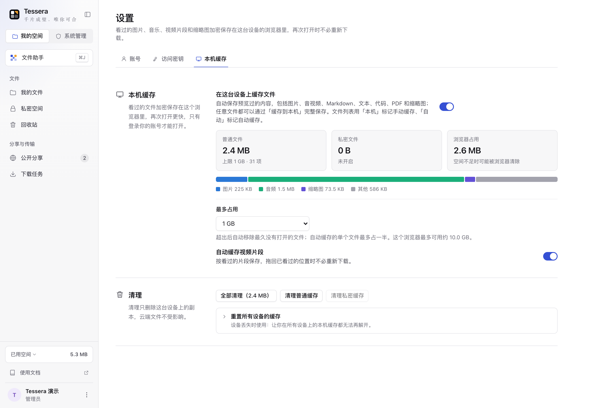<p align="center"><sub>本机缓存：设备容量、分类用量与自动缓存</sub></p></td>
</tr>
</table>

<details>
<summary><b>更多界面：图片、Markdown、下载任务、控制台与文档站</b></summary>

<table>
<tr>
<td width="50%">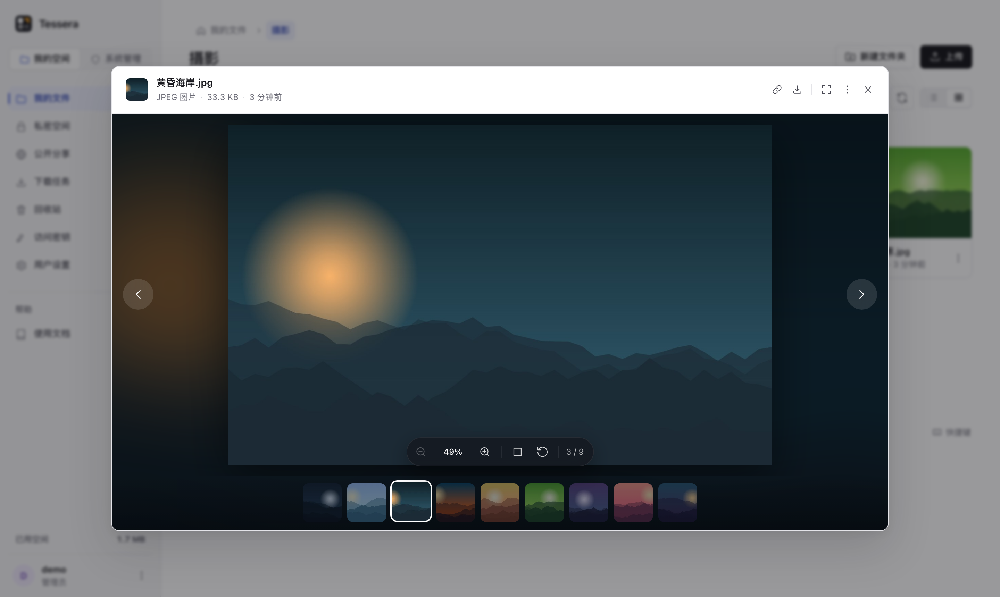<p align="center"><sub>图片查看器</sub></p></td>
<td width="50%">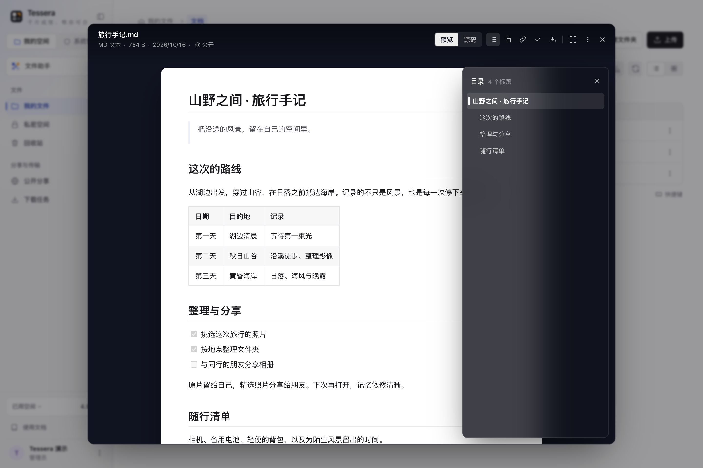<p align="center"><sub>Markdown 阅读</sub></p></td>
</tr>
<tr>
<td>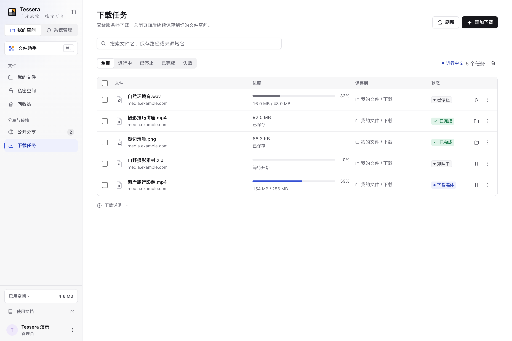<p align="center"><sub>离线下载任务</sub></p></td>
<td>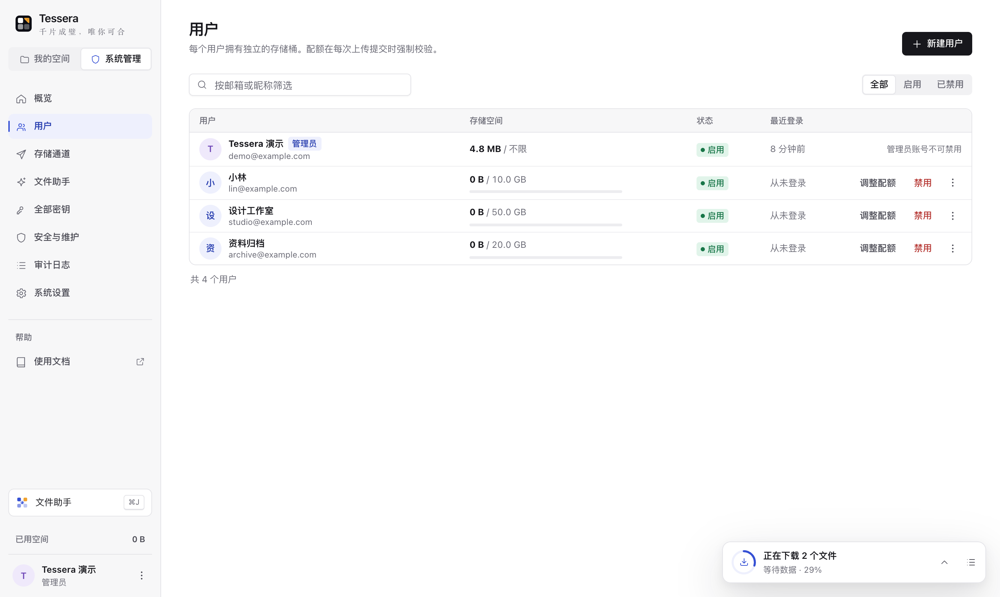<p align="center"><sub>账号与配额管理</sub></p></td>
</tr>
<tr>
<td>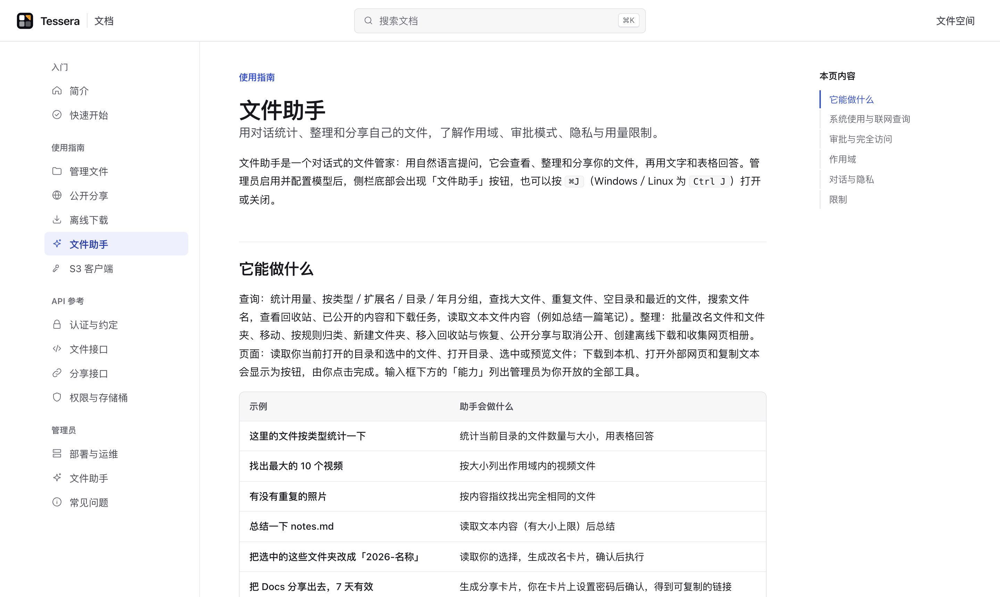<p align="center"><sub>内置文档站</sub></p></td>
<td>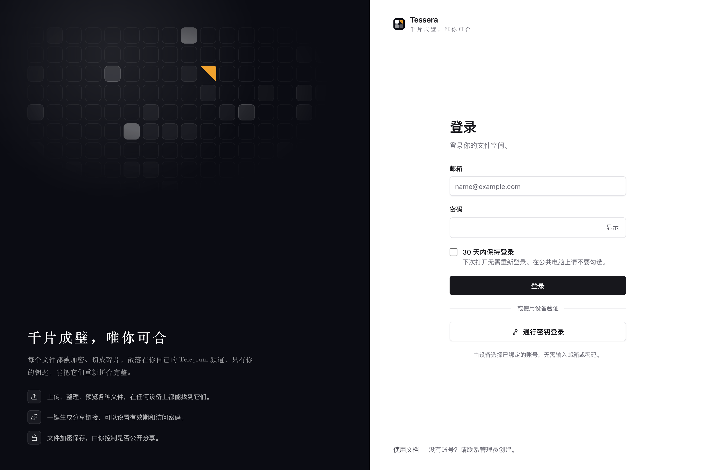<p align="center"><sub>登录与设备验证</sub></p></td>
</tr>
</table>

</details>

<p align="center">
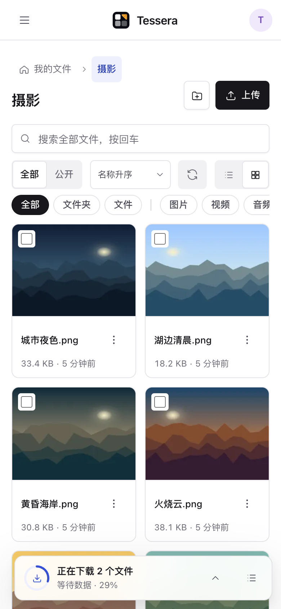
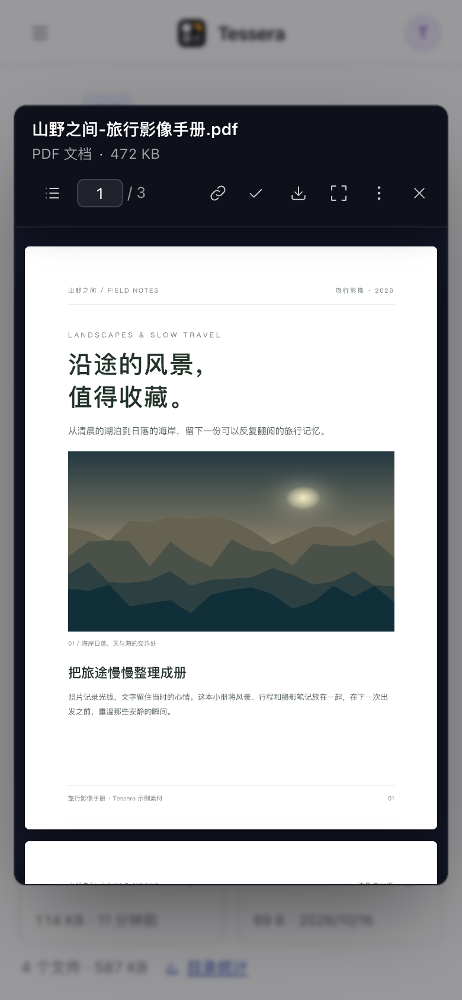
<br><sub>手机上的文件浏览与 PDF 阅读</sub>
</p>

<sub>截图来自本地运行的 Tessera，文件、账号和相册均为合成示例。助手使用固定回复的演示模型；下载列表使用演示任务状态，不代表模型能力或真实下载速度。</sub>

## 快速开始

需要 **Docker 与 Docker Compose**。对外使用时准备 HTTPS 站点；使用 Telegram 存储还需确保服务器能连接 Telegram Bot API。

```bash
git clone https://github.com/yangshoulai/tgdrive.git
cd tgdrive
docker compose pull
```

### 1. 选择运行方式

**本机体验：** 使用 HTTP 开发配置，无需先配置 Telegram 或模型服务。

```bash
docker compose -f docker-compose.yml -f docker-compose.dev.yml up -d --no-build
```

打开 <http://localhost:8000/>。开发配置启用 `TGDRIVE_INSECURE_COOKIES=1`，只用于本机或受信任的开发环境，不要用它对外部署。通行密钥在本地使用 `localhost`，对外使用 HTTPS 域名。

**长期部署：** 配置反向代理与 HTTPS，使用默认配置启动。

```bash
docker compose up -d --no-build
```

通过自己的 HTTPS 地址访问。反向代理需保留 `Host`、正确传递 HTTPS 协议与客户端地址，允许大文件请求和长连接；上传、下载与 SSE 不应被代理缓冲或过早超时。容器监听 `8000` 端口，`/healthz` 提供健康检查。

以上命令使用预构建镜像；从源码构建可改用 `docker compose up -d --build`。数据保存在 Compose 的 `tgdrive-data` 命名卷中，容器重建后继续使用原卷。

默认入口脚本在必要时修正数据目录权限，再以 uid `10001` 运行服务。若在 Compose 中自行指定 `user:`，需保证 `/data` 对该用户可写。

### 2. 完成初始化

1. 按页面提示设置**加密口令**，创建管理员账号。
2. 在「系统管理 → 系统设置 → 访问地址」填写公开访问地址与 S3 Endpoint；按部署网络配置可信代理。
3. 在「存储通道」连接 Telegram。未配置通道时，新文件先保存在本地分片目录。
4. 按需创建其他账号、设置配额，或在「系统设置 → 注册」开放访客注册。邮箱验证码方式需要先配置 SMTP；邀请码支持批量创建、失效时间、独立额度和直接注册链接。也可按需启用文件助手或下载组件。

> [!IMPORTANT]
> **加密口令和账号登录密码是两回事。** 加密口令用于解锁存储，无法找回；服务重启后，需由管理员登录并再次解锁。请同时保管好口令与数据库备份。

<a id="连接-telegram"></a>

### 3. 连接 Telegram

1. 通过 [@BotFather](https://t.me/BotFather) 创建 Bot，取得 token。
2. 新建**私有频道**，把 Bot 添加为具有发布消息权限的管理员。
3. 取得以 `-100` 开头的频道 ID。
4. 在「存储通道 → 添加通道」填写显示名称、token 和频道 ID。保存后会检查 token、频道访问与发消息权限；页面内也有完整配置指南。

启用后，新分片写入 Telegram；原有本地分片不会自动迁移，仍需保留本地数据。可以增加通道分担上传，停用的通道不再接收新分片，已有分片仍可读取。token 加密保存在数据库中。

<a id="镜像"></a>

### 镜像与组件

镜像地址：`ghcr.io/yangshoulai/tgdrive`。按需要修改 Compose 的 `image` 标签：

| 变体 | 滚动标签 | 固定版本示例 | 包含的能力 |
| --- | --- | --- | --- |
| 基础 | `1`、`latest` | `1.16.1` | 文件管理、全部网页预览、分享、文件助手、HTTP API / S3、直链下载 |
| FFmpeg | `1-ffmpeg`、`latest-ffmpeg` | `1.16.1-ffmpeg` | 基础能力 + 服务器生成媒体缩略图、M3U8 封装 |
| 平台 | `1-platform`、`latest-platform` | `1.16.1-platform` | FFmpeg 变体 + X / YouTube 下载所需的 yt-dlp、gallery-dl 与 Node.js |

另提供次版本标签（如 `1.16` 及对应后缀）。`1` 跟随主版本内的更新，完整版本标签用于固定部署；当前版本见[发布记录](https://github.com/yangshoulai/tgdrive/releases)。同一主版本内保持数据库、HTTP API 与 S3 的兼容，具体变化及升级说明见 [CHANGELOG.md](CHANGELOG.md)。

安装组件后，仍需在「系统设置 → 下载与资源」启用对应下载来源。文件助手的总开关与模型在控制台「文件助手」中配置，不因镜像变体而自动启用。

<details>
<summary>从源码构建其他镜像变体</summary>

```bash
# 带 FFmpeg 的基础镜像
docker build --build-arg INSTALL_FFMPEG=1 -t tessera:ffmpeg .

# 包含平台下载组件的镜像
docker build --target platform -t tessera:platform .
```

</details>

## 文件助手

在右下角系统托盘中打开「文件助手」，或按 `⌘J` / `Ctrl+J`，一边浏览文件，一边处理当前目录。输入 `@` 引用文件与文件夹；支持识图的模型还可以查看图片。

| 你可以这样说 | 助手可以协助完成 |
| --- | --- |
| “统计这个文件夹的类型和占用，找出最大的文件” | 汇总容量、分类与大文件 |
| “这里有没有重复照片” | 按内容指纹查找完全相同的文件 |
| “总结这篇旅行手记” | 在读取上限内获取文本，再生成摘要 |
| “把这些照片统一改成旅途加序号” | 展示新旧名称与冲突情况，生成待确认方案 |
| “这个相册缓存到本机了吗” | 查询当前浏览器的缓存状态，生成缓存或清除卡片 |
| “把这个网页相册保存到摄影目录” | 分析图片与分页线索，生成待确认的下载方案 |

- **范围由你决定。** 可以限定当前目录或指定目录，发送前可检查输入框下方的访问范围。系统目录始终不对助手开放；私密文件需管理员允许并在私密空间解锁后才能处理，未解锁时助手会请你先解锁。
- **修改可以先审阅。** 默认审批模式，由你确认操作卡片后执行。管理员允许时可切换完全访问；公开分享、彻底删除、大批量操作及读取过文件内容或外部内容后的修改仍需确认。改名、移动等可撤销操作在 24 小时内提供撤销入口。
- **模型与额度自行配置。** 管理员添加 OpenAI 兼容或 Anthropic 渠道，选择支持工具调用的模型，也可连接本地或内网模型服务。首次使用需确认数据使用说明；应用不附带模型额度，实际效果取决于模型与渠道。
- **私密对话随锁定隐藏。** 涉及私密空间的对话加密保存在历史中，私密空间锁定后需要解锁才能查看或继续。使用外部模型时，相关上下文仍会发送给该模型服务。

启用入口：「文件助手 → 渠道与模型」配置渠道、模型和默认模型，再在「概览」打开总开关；「权限与工具」设置工具范围与用户策略，「用量与日志」查看调用情况。

[使用指南](https://tessera.yangshoulai.xyz/docs/assistant) · [权限与实现设计](docs/assistant-design.md)

## 离线下载

在「下载任务」中粘贴链接或 bash 格式 curl / wget 命令，解析候选、选择保存目录后开始。任务由服务器持久保存，关闭网页不影响执行；重启后先解锁系统，私密任务还需重新解锁并继续。

| 来源 | 支持范围 | 需要的镜像 |
| --- | --- | --- |
| HTTP(S) 直链 | 单条或多条链接；curl / wget 的请求头、Cookie、GET / POST 与文本请求体 | 基础 |
| M3U8 点播 | H.264 / AAC，TS、fMP4、字节范围、普通 AES-128 与独立音轨，封装为 MP4 | FFmpeg |
| X | 单条帖子中的图片与视频 | 平台 |
| YouTube / Shorts | 单个视频可用的 H.264 / AAC 格式，可选清晰度或只保存 M4A 音轨 | 平台 |

支持任务搜索、状态筛选、批量操作、停止与继续、更新过期链接或 Cookie。GET 直链在来源支持且版本一致时从已保存分段续传；网络临时故障会自动重试。POST 不自动重发，M3U8 与平台视频继续时从头处理。

下载可保存到普通目录或已解锁的私密空间；同名文件自动改名。并发、限速、磁盘保留空间、临时缓存与 YouTube 清晰度由管理员配置。临时缓存上限主要约束需合并的输入轨，不是所有文件统一的大小上限。

不支持磁力 / 种子、直播、DRM、SAMPLE-AES 或频道 / 播放列表批量下载；视频只封装、不转码。来源权限、Cookie、地区和服务器出口会影响下载，解析成功不保证来源始终允许读取。

[使用指南](https://tessera.yangshoulai.xyz/docs/downloads) · [离线下载设计](docs/offline-downloads.md) · [平台下载](docs/platform-downloads.md) · [排障说明](docs/offline-reliability.md)

<a id="油猴脚本"></a>
<a id="浏览器脚本"></a>

## 网页资源抓取

配套的 [Tessera 资源抓取脚本](userscripts/tessera-grabber.user.js) 从已加载的网页中收集图片、视频、音频、M3U8 与常见文件，在悬浮面板中预览、选择和批量保存；X 与 YouTube 另有页面操作入口。

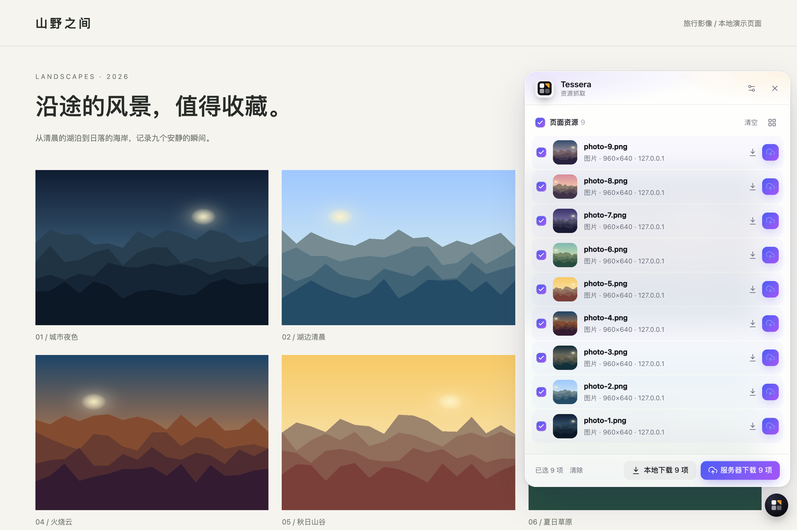

| 方式 | 数据路径 | 适用情况 |
| --- | --- | --- |
| **服务器下载** | 来源 → Tessera 服务器 → 加密存储 | 大文件、M3U8、X / YouTube，提交后无需保持来源网页打开 |
| **本地下载** | 来源 → 浏览器 → 上传 Tessera | 浏览器能读取的图片与文件直链；“本地”指在浏览器读取，最终仍保存到网盘 |
| **发给文件助手** | 图片候选与分页线索 → Tessera 页面 | 确认后交给助手分析、整理相册下载方案，不转交页面正文 |

1. 桌面安装 **Tampermonkey / Violentmonkey** 并导入[脚本文件](userscripts/tessera-grabber.user.js)；iPhone / iPad 使用 **Userscripts + Safari**，授予相应网站访问权限。
2. 在 Tessera 头像菜单「设置 → 访问密钥」创建读写密钥，建议限定到专用收集目录。
3. 在脚本面板的「设置」中填写 Tessera 地址、`AccessKeyId:Secret` 和默认目录，按网站启用资源收集。

两种下载方式都有确认页，可选择目录、修改文件名并移除条目。保存到私密空间时，脚本会转交 Tessera 页面，由你登录、解锁后接收；不要在来源网页输入账号密码。

<details>
<summary>使用边界</summary>

- 本地下载仅支持 HTTP(S) 直链，单文件最多 64 MiB、每批最多 50 项；M3U8 / DASH 和平台视频走服务器下载。传输期间保持来源网页打开。
- 已探测资源在关闭面板或站内换页后保留，手动清空或刷新网页才移除。同名文件不会被脚本直接覆盖，需改名后重试。
- 服务器下载所需的来源 Cookie 会交给你配置的 Tessera 服务器；本地上传不转发来源 Cookie，Tessera 密钥也不进入来源请求。
- iOS Userscripts 无脚本菜单与 `GM_cookie`，通过悬浮按钮设置，无法读取 HttpOnly Cookie。跨域、来源验证与窗口通信策略仍可能阻止读取或私密转交。

</details>

## 客户端接入

在头像菜单「设置 → 访问密钥」创建密钥；Secret 只显示一次。访问密钥按授权目录限制只读或读写，不能访问私密空间。每个用户的存储桶名形如 `user-2`。

HTTP API 与网页共用站点地址。使用 S3 时，给它配置独立域名，指向同一个服务，并在控制台填写 S3 Endpoint。

```bash
# HTTP API：列出 docs/ 下的文件
curl -H 'Authorization: Bearer <AccessKeyId>:<Secret>' \
  'https://drive.example.com/api/v1/list?prefix=docs/'

# S3：按提示输入 AccessKeyId、Secret，区域填写 us-east-1
aws configure --profile tessera
aws configure set profile.tessera.s3.addressing_style path
aws configure set profile.tessera.s3.signature_version s3v4
aws --profile tessera --endpoint-url https://s3.example.com s3 ls s3://user-2/
```

HTTP API 提供列表、搜索、上传、下载、移动、复制、删除、公开分享、秒传与离线下载。网页会话接口使用 Cookie 与 CSRF；脚本应使用访问密钥接口 `/api/v1`。

S3 网关支持 SigV4、预签名 URL、列表、Range 读取、上传、复制、批量删除、分段上传与分段复制；可接入 rclone、AWS CLI、boto3。**不支持**版本控制、ACL、生命周期、对象锁或 POST 表单上传，不能替代全部 AWS S3 功能。

[HTTP API](https://tessera.yangshoulai.xyz/docs/api-basics) · [文件接口](https://tessera.yangshoulai.xyz/docs/api-files) · [S3 配置与兼容性](https://tessera.yangshoulai.xyz/docs/s3)

<a id="工作原理"></a>
<a id="安全模型与限制"></a>

## 工作原理与使用边界

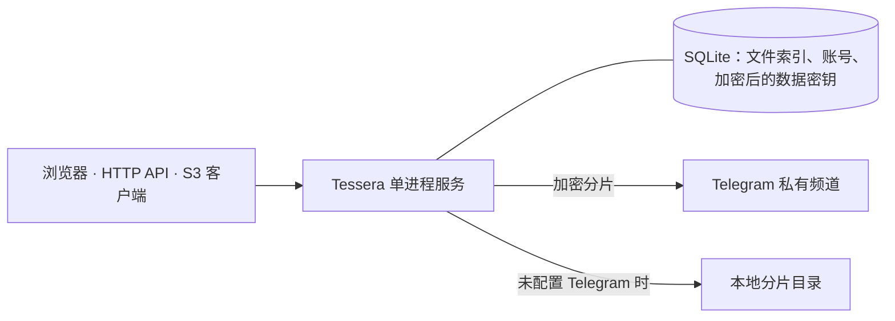

- **服务端加密。** 加密口令经 Argon2id 派生主密钥，文件内容使用独立数据密钥；默认按 16 MiB 分片、64 KiB 帧做 AES-256-GCM 加密。主密钥只在运行中的进程内存里保存，更换口令时重新包装数据密钥。
- **不是端到端加密。** 服务器处理文件明文；文件名、路径、大小等元数据保存在 SQLite 中。内容加密保护 Telegram 侧和存储介质上的文件数据，不防御运行中的服务器被控制。管理界面不提供跨账号浏览用户文件或查看助手对话正文的入口。
- **SQLite 是还原文件所需的索引。** 对应的文件分片、数据库与加密口令缺一不可。秒传、复制与保存分享可复用同一份加密内容，副本仍按原始大小计入账号配额。
- **只运行一个服务进程。** 会话、私密授权、限流及连接池依赖进程内状态，不要启用多个 worker 或让多个实例共享数据目录。
- **预览有明确范围。** 文本、Markdown、代码最多展示前 16 MiB；Office 文件与压缩包不提供在线内容预览，带打开密码的 PDF 需下载后查看。音视频兼容性取决于浏览器与编码。
- **缩略图按预算生成。** 上传与预览优先复用已有数据；配置 FFmpeg 后，后台还会为较早上传且缺图的媒体按每日预算补图，也可手动生成。PDF、Office 和 SVG 不生成媒体缩略图。
- **本机缓存用于加速。** 缓存加密保存在当前浏览器，仍需登录和有效授权，私密内容还需解锁；它不是离线备份，也不占账号存储配额。
- **外部服务各有边界。** Telegram 影响传输速度、限流与可用性；模型服务接收其需要的上下文并可能计费。请自行保管服务凭据，并了解相关服务的数据政策与使用规则。

<a id="备份与恢复"></a>

## 备份、升级与恢复

在「系统管理 → 安全与维护 → 维护与备份」创建加密备份，保存为数据目录 `backups/` 下的 `*.tgdbak`。备份包含元数据库、索引、账号、配置和加密后的数据密钥，**不包含文件分片**。

把备份复制到服务器以外的位置，并保留对应的加密口令。使用本地存储时，还要备份 `blobs/`；即使后来启用了 Telegram，原有本地分片也仍需保留。

**升级：** 先备份，再在原 Compose 项目目录执行，复用现有数据卷。

```bash
docker compose pull
docker compose up -d --no-build
```

数据库会在启动时自动迁移，重启后需再次解锁。切换镜像变体时也使用原数据卷。

**恢复：** 先停止服务，在能访问备份和数据目录的环境中运行：

```bash
tgdrive restore /path/to/backup.tgdbak --data-dir /path/to/data
```

Docker Compose 部署可使用同一服务的数据卷执行恢复；将下面的文件名替换为实际备份文件：

```bash
docker compose stop tgdrive
docker compose run --rm --no-deps tgdrive \
  restore /data/backups/backup.tgdbak --data-dir /data
docker compose up -d --no-build
```

命令提示输入备份时的口令，原数据库保留为 `meta.db.before-restore-*`。如果使用本地分片，还需确保与备份对应的 `blobs/` 可用。审计归档可用 `tgdrive audit-export <归档文件> --output audit.jsonl` 导出。

<a id="配置"></a>
<a id="本地开发"></a>

## 配置与本地开发

控制台中的配置优先于启动参数；启动参数与对应环境变量用于提供默认值。

| 参数 | 环境变量 | 用途 |
| --- | --- | --- |
| `--data-dir` | `TGDRIVE_DATA_DIR` | 数据目录，默认 `./data`，容器内为 `/data` |
| `--host` / `--port` | `TGDRIVE_HOST` / `TGDRIVE_PORT` | 监听地址与端口，容器内为 `0.0.0.0:8000` |
| `--public-url` | `TGDRIVE_PUBLIC_URL` | 对外访问地址，用于分享链接与文档示例 |
| `--s3-endpoint` | `TGDRIVE_S3_ENDPOINT` | S3 客户端使用的完整 Endpoint |
| `--trusted-proxies` | `TGDRIVE_TRUSTED_PROXIES` | 信任转发协议和客户端地址的代理 IP 或网段，逗号分隔 |
| `--insecure-cookies` | `TGDRIVE_INSECURE_COOKIES=1` | 允许 HTTP 下使用会话 Cookie，仅限开发 |
| `--resource-mode` | `TGDRIVE_RESOURCE_MODE` | 资源模式：`auto`、`low`、`custom` |

更多参数见 `tgdrive --help` 与 [docker-compose.yml](docker-compose.yml)。可信代理只填写实际代理地址，不在不受控的网络中使用 `*`。

<details>
<summary><b>从源码运行</b>（Python 3.12+、Node.js 20+）</summary>

```bash
python3.12 -m venv .venv
.venv/bin/pip install -e '.[dev]'
(cd web && npm ci)
(cd web && node build-apps.mjs)
.venv/bin/tgdrive --data-dir /tmp/tessera-dev --port 8000 \
  --static-dir web/dist --insecure-cookies
```

前端没有单独的开发服务器；修改后重新运行 `web/build-apps.mjs` 并刷新页面。后端与网页由同一进程提供。服务器生成媒体缩略图与封装视频需安装 FFmpeg；平台下载另需可选依赖和 JavaScript 运行时。

项目现有检查入口为 `make check PYTHON=.venv/bin/python`，包含静态检查、后端测试、前端类型检查与构建。

</details>

## 使用文档

每个实例的 `/docs/` 内置使用指南、接口参考与部署管理指南，所有内容均公开，访客无需登录即可阅读。文档可访问 [tessera.yangshoulai.xyz/docs](https://tessera.yangshoulai.xyz/docs/)。该部署实例不开放注册。

- [快速上手](https://tessera.yangshoulai.xyz/docs/quickstart) · [文件与预览](https://tessera.yangshoulai.xyz/docs/files) · [账号与设置](https://tessera.yangshoulai.xyz/docs/account)
- [文件助手](https://tessera.yangshoulai.xyz/docs/assistant) · [下载与资源抓取](https://tessera.yangshoulai.xyz/docs/downloads) · [分享](https://tessera.yangshoulai.xyz/docs/sharing)
- [HTTP API](https://tessera.yangshoulai.xyz/docs/api-basics) · [S3](https://tessera.yangshoulai.xyz/docs/s3)
- 开发资料：[架构](docs/architecture-v2.md) · [文件助手设计](docs/assistant-design.md) · [本机缓存设计](docs/client-cache-design.md) · [缩略图流程](docs/thumbnail-pipeline.md)
- 项目约定：[AGENTS.md](AGENTS.md) · [DESIGN.md](DESIGN.md) · [UX-CONTRACT.md](UX-CONTRACT.md)

遇到问题可提交 [Issue](https://github.com/yangshoulai/tgdrive/issues)，附上版本、部署方式、复现步骤与脱敏日志。请勿提交真实文件、密码、访问密钥或来源 Cookie。

## 许可证

本项目采用 [MIT License](LICENSE)。允许使用、修改、再分发和商用，须保留版权与许可声明；第三方依赖遵循各自的许可证。
