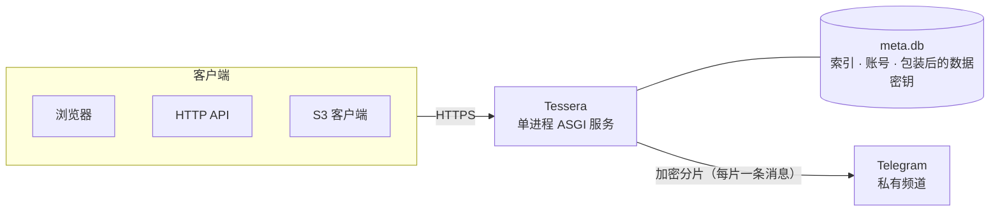

<div align="center">


# Tessera

**把 Telegram 私有频道变成你的加密网盘。**

自托管加密存储 · AI 文件助手 · 离线下载 · 网页资源抓取 · HTTP API / S3

[](https://github.com/yangshoulai/tgdrive/tags)
[](https://github.com/yangshoulai/tgdrive/pkgs/container/tgdrive)
[](pyproject.toml)
[](web/package.json)
[](#客户端接入)
[](LICENSE)

[**快速开始**](#快速开始) · [**功能特性**](#功能特性) · [**文件助手**](#文件助手) · [**离线下载**](#离线下载) · [**油猴脚本**](#油猴脚本) · [**在线文档**](https://tessera.yangshoulai.xyz/docs/)

<br>

<picture>
  <source media="(prefers-color-scheme: dark)" srcset="docs/screenshots/grid-dark.png">
  
</picture>

</div>

## 简介

Tessera 是面向个人与小团队的自托管网盘：在服务端加密文件、切成分片，通过 Telegram Bot API 保存到**你自己的私有频道**。文件索引与包装后的数据密钥保存在服务器本地的 SQLite 数据库中，Telegram 接收的是密文分片。

从上传、预览、整理到分享，都可以在网页中完成；文件助手用自然语言协助查找与批量整理，离线下载和配套油猴脚本负责把网页资源收进网盘。需要接入现有工具时，还可以使用 HTTP API 与 S3 兼容网关。

**一个容器、单个 Python 进程，使用 SQLite 管理元数据，无需额外部署数据库或消息队列。** 文件助手和平台下载按需启用；未配置 Telegram 时也可使用本地存储体验。

> 作者自用的部署实例位于 **<https://tessera.yangshoulai.xyz>**，不开放注册；其中的[文档站](https://tessera.yangshoulai.xyz/docs/)对所有人公开，可以先在那里了解完整的使用说明与 API。

<table>
<tr>
<td width="33%" valign="top">

### 🔐 加密存储，自行掌控

Argon2id 派生主密钥，每个文件独立数据密钥，AES-256-GCM 分帧加密。Telegram 只看到密文分片。

</td>
<td width="33%" valign="top">

### 🗂️ 日常文件体验

分块上传与秒传、连续目录浏览、搜索与筛选；图片、音视频、Markdown 和代码沉浸预览，支持深色与手机端。

</td>
<td width="33%" valign="top">

### ✨ AI 文件助手

用对话查找文件、统计用量、批量改名与归类。限定目录范围，修改以操作卡片呈现，默认确认后执行。

</td>
</tr>
<tr>
<td valign="top">

### ⬇️ 服务器离线下载

粘贴直链或 curl / wget 命令，服务器下载后加密保存；可选 M3U8、X 与 YouTube，关闭网页后继续运行。

</td>
<td valign="top">

### 🧭 网页资源抓取

油猴脚本收集网页资源，批量发送服务器下载，或由浏览器读取后上传；支持桌面脚本管理器与 iOS Safari。

</td>
<td valign="top">

### 🔗 分享与工具接入

文件和文件夹分享、密码与有效期、私密空间；通过 HTTP API / S3 接入脚本、rclone、AWS CLI 等工具。

</td>
</tr>
</table>

## 截图

<table>
<tr>
<td width="50%"><p align="center"><sub>文件管理：连续浏览、组合筛选、列表与网格切换</sub></p></td>
<td width="50%"><p align="center"><sub>图片查看器：缩放、旋转、同目录胶片条</sub></p></td>
</tr>
<tr>
<td><p align="center"><sub>音乐播放器：滚动歌词、播放列表、最小化后继续播放</sub></p></td>
<td><p align="center"><sub>沉浸阅读：Markdown 排版、标题目录、渲染与源码切换</sub></p></td>
</tr>
<tr>
<td><p align="center"><sub>文件助手：自然语言整理、访问范围、操作确认卡片</sub></p></td>
<td><p align="center"><sub>离线下载：队列、阶段进度、停止与继续</sub></p></td>
</tr>
<tr>
<td><p align="center"><sub>文件夹分享页：访客浏览、打包下载、保存到自己的 Tessera</sub></p></td>
<td><p align="center"><sub>管理控制台：用户与配额、存储通道、审计、维护</sub></p></td>
</tr>
<tr>
<td><p align="center"><sub>内置文档站：使用指南、API 参考、S3 兼容性，⌘K 搜索</sub></p></td>
<td><p align="center"><sub>登录：账号密码或通行密钥（Passkey）</sub></p></td>
</tr>
</table>

<p align="center"><br><sub>手机端</sub></p>

<sub>截图均来自当前源码构建的独立本地实例，使用合成文件与示例账号；助手使用固定回复的演示模型，下载任务状态为演示数据，不代表真实模型效果或下载测速。油猴脚本截图见下文。</sub>

## 功能特性

<details open>
<summary><b>存储与加密</b></summary>

- 每个文件有独立的数据密钥，由加密口令经 **Argon2id** 派生的主密钥包装；内容以 16 MiB 分片、64 KiB 帧做 **AES-256-GCM** 加密。
- 存储后端为 Telegram 私有频道，支持多个 Bot 轮换与故障冷却；未配置 Bot 时使用本地目录，便于开发测试。
- **秒传**在当前用户有权访问的普通文件中匹配内容指纹；服务端复制和保存他人分享复用已有加密数据，避免重复上传，仍计入目标账号配额。
- 读取时按需下载并解密对应分片，支持 HTTP Range 与视频拖动。

</details>

<details open>
<summary><b>网页端</b></summary>

- **文件管理**：大文件分块并行上传与断点续传，移动、重命名、回收站、配额、按文件名搜索；目录连续浏览、组合筛选、列表 / 网格视图与键盘快捷键。
- **在线预览**：图片查看器，音视频播放（播放列表、字幕、歌词），文本、代码与 Markdown（含标题目录）；预览可固定、最小化与跨页播放，图片／视频／音频封面支持服务器后台生成（需 FFmpeg），网页上传可用本地文件生成，也可由用户手动生成，结果加密保存。
- **公开分享**：文件和文件夹均可分享，支持密码、有效期和下载次数统计；访客可打包下载 ZIP，登录用户可把分享保存到自己的空间。
- **私密空间**：需要再次验证（登录密码或通行密钥）才能访问的独立目录，闲置自动锁定，独立回收站。
- **账号与管理**：邮箱登录，头像与昵称，通行密钥登录；管理员控制台管理用户、配额、存储通道、访问密钥、审计日志、备份与维护任务。
- **内置文档站**：`/docs/` 提供使用说明、API 与 S3 兼容性文档；管理员文档仅对管理员会话下发。
- **本机缓存**：所有可预览文件读过的内容（图片、音视频、Markdown、文本、代码、PDF）与缩略图自动加密缓存在浏览器里，也可手动把任意文件完整缓存到本机；完整与部分缓存都能逐项或批量清除。容量按设备设置，私密文件只在信任的设备上缓存，管理员可整体关闭。
- 深色模式（跟随系统或手动切换）与手机端适配。

</details>

<details open>
<summary><b>AI 文件助手</b></summary>

- 用自然语言搜索、统计、查重、读取文本，生成改名、移动、归类、分享与离线下载方案。
- 在侧边抽屉中处理当前目录与所选文件，支持 `@` 引用、流式回复、工具时间线与历史对话。
- 默认审批模式；管理员可按需允许完全访问。系统目录不对助手开放；私密空间只能在单独的私密对话中处理，对话不落盘，锁定即结束。
- 管理员自备 OpenAI 兼容或 Anthropic 模型渠道，也可连接本地模型服务；支持模型目录、工具开关、用户策略与用量额度。

</details>

<details open>
<summary><b>程序访问</b></summary>

- `/api/v1`：访问密钥认证的 HTTP API，覆盖列表、搜索、上传、下载、移动、复制、删除、公开分享、秒传与离线下载。
- **S3 兼容网关**：SigV4 签名与预签名 URL，可直接使用 rclone、AWS CLI、boto3 等工具。
- 访问密钥可按存储桶与路径前缀授予只读或读写权限，所属用户被禁用时自动失效。

</details>

<details open>
<summary><b>离线下载</b></summary>

- 服务器代为下载 HTTP(S) 直链，或解析浏览器复制的 bash 格式 curl / wget 命令；支持任务搜索、状态筛选、停止、继续、更新参数与自动重试。
- 可选组件：M3U8 点播封装、X 单条帖子的图片与视频、YouTube 单视频与 Shorts，也可仅保存音轨。
- 配套[油猴脚本](#油猴脚本)，提供资源嗅探、批量保存、浏览器下载后上传、私密空间转交与「发给文件助手」。

</details>

## 工作原理



| 层级 | 做法 |
| --- | --- |
| 主密钥 | 加密口令经 Argon2id 派生，只存在于进程内存中 |
| 数据密钥 | 每个文件一把，用主密钥包装后存入 `meta.db`；更换口令只需重新包装，不必重新加密文件 |
| 分片加密 | 数据密钥经 HKDF 派生分片密钥，内容按 64 KiB 帧做 AES-256-GCM 认证加密 |
| 分片大小 | 默认 16 MiB，上传与读取按分片处理，大文件不必整体放入内存 |

## 安全模型与限制

部署前请了解以下事实：

- **加密口令无法找回。** 所有数据密钥都由它保护，遗失后已存储的文件无法解密。
- **重启后需要人工解锁。** 主密钥只存在于内存中。服务启动后处于锁定状态，普通用户无法登录，公开链接返回 503，直到管理员登录并输入加密口令。
- **管理界面遵循账号隔离。** 系统管理只提供文件数量、容量等统计，不提供用户文件列表、预览或下载；助手管理页只显示对话元数据与用量，不下发对话正文。审计不记录文件名、路径或来源凭据。
- **这不是端到端加密。** 加密在服务端完成，全系统共用一把主密钥；能控制服务器或管理员账号的人在技术上可以读取所有用户的文件。它防护的是 Telegram 侧和存储介质上的数据泄露。
- **文件助手会向所选模型服务发送上下文。** 包括对话、访问范围内的文件名、目录结构，以及工具实际读取的文本与结果；首次使用需确认说明。私密空间只在管理员允许的私密对话中使用（对话只保存在服务器内存里），使用外部模型时请同时考虑其数据政策与调用费用。
- **`meta.db` 是唯一的索引。** 丢失数据库后，频道中的分片将无法还原为文件。请定期[备份](#备份与恢复)。
- **只支持单进程运行。** 会话、登录限流和 Telegram 客户端池保存在进程内存中，不要使用多个 worker 或让多个实例共享数据目录。
- **依赖 Telegram 云端 Bot API。** 上传下载速度、限流和可用性受 Telegram 约束，请自行评估是否符合 Telegram 的服务条款和你的使用场景。

## 快速开始

需要 Docker 与 Docker Compose。

**本机体验（HTTP）**

```bash
git clone https://github.com/yangshoulai/tgdrive.git
cd tgdrive
docker compose -f docker-compose.yml -f docker-compose.dev.yml up -d --build
```

打开 <http://127.0.0.1:8000/>，按页面提示设置加密口令并创建管理员账号。未配置 Telegram 时先使用本地分片目录；随后可以[连接 Telegram](#连接-telegram)、[启用文件助手](#文件助手)或选择下载所需的镜像。`docker-compose.dev.yml` 允许在 HTTP 下使用 Cookie（`TGDRIVE_INSECURE_COOKIES=1`），仅用于本机体验与开发。

**生产部署**

使用 GitHub Container Registry 上的镜像，删除 `docker-compose.yml` 中的 `build` 部分后执行：

```bash
docker compose pull
docker compose up -d
```

请在反向代理后启用 HTTPS，并在控制台「系统设置」中填写公开访问地址与 S3 Endpoint（也可用启动参数设置）。通行密钥要求站点使用 HTTPS 域名。容器监听 `8000` 端口，数据目录为 `/data`，`/healthz` 可用于健康检查。

> [!NOTE]
> 容器以 root 启动，入口脚本在数据目录属主不是 uid 10001 时修正属主，然后降权运行服务，因此命名卷和 `./data:/data` 这类宿主机目录都可直接使用。如果在 Compose 中用 `user:` 指定了其他用户，需要自行保证 `/data` 可写。

### 镜像

镜像地址为 `ghcr.io/yangshoulai/tgdrive`，每次发布版本时由 GitHub Actions 构建三个变体：

| 标签 | 内容 | 适用场景 |
| --- | --- | --- |
| `1`、`1.3`、`1.3.1`、`latest` | 基础镜像 | 文件存储、预览、分享、文件助手、直链离线下载 |
| `1-ffmpeg`、`1.3-ffmpeg`、`1.3.1-ffmpeg`、`latest-ffmpeg` | 基础镜像 + FFmpeg | 服务器自动生成图片／音视频缩略图、下载 M3U8 |
| `1-platform`、`1.3-platform`、`1.3.1-platform`、`latest-platform` | FFmpeg + yt-dlp、gallery-dl、Node.js | 还需要下载 X / YouTube 媒体 |

版本号遵循语义化版本：同一主版本内（`1.x.y`）的升级保持数据库、`/api/v1`、S3 网关兼容，启动时自动迁移数据库。生产环境建议固定主版本标签（如 `1`），这样能自动获得修复又不会跨越不兼容的升级；每个版本的变化见 [CHANGELOG.md](CHANGELOG.md)，升级前建议先做一次加密备份。

表中以 `1.3.1` 举例，实际版本见[发布记录](https://github.com/yangshoulai/tgdrive/releases)。下载功能还需要在控制台「系统设置 → 下载与资源」中启用；文件助手在「文件助手」页单独配置。使用预构建变体时也要调整 Compose 中的 `image` 标签；本地构建对应变体可用 `docker build --build-arg INSTALL_FFMPEG=1 .` 或 `docker build --target platform .`。

### 连接 Telegram

1. 通过 [@BotFather](https://t.me/BotFather) 创建 Bot，获得 token。
2. 创建一个私有频道，把 Bot 添加为可以发布消息的管理员。
3. 在控制台「存储通道」中添加 Bot token 与频道，系统会自动检查 token、频道访问和发布权限。

启用存储通道后，新写入的文件保存到频道；Bot token 加密后保存在数据库中，接口不会返回明文。可以添加多个 Bot 分担上传和下载。

## 配置

启动参数与对应的环境变量等效；控制台中的系统设置优先于启动参数。

| 参数 | 环境变量 | 说明 |
| --- | --- | --- |
| `--data-dir` | `TGDRIVE_DATA_DIR` | 数据目录（元数据库、本地分片、备份），默认 `./data` |
| `--host` | `TGDRIVE_HOST` | 监听地址，默认 `127.0.0.1`（镜像中为 `0.0.0.0`） |
| `--port` | `TGDRIVE_PORT` | 监听端口，默认 `8000` |
| `--public-url` | `TGDRIVE_PUBLIC_URL` | 对外访问地址，用于分享链接、API 与文档示例 |
| `--s3-endpoint` | `TGDRIVE_S3_ENDPOINT` | S3 客户端使用的完整 Endpoint |
| `--trusted-proxies` | `TGDRIVE_TRUSTED_PROXIES` | 信任其 `X-Forwarded-For` / `X-Forwarded-Proto` 的代理 IP 或网段，逗号分隔 |
| `--insecure-cookies` | `TGDRIVE_INSECURE_COOKIES=1` | 允许 HTTP 下的会话 Cookie，仅限本地开发 |

<details>
<summary>更多参数</summary>

| 参数 | 环境变量 | 说明 |
| --- | --- | --- |
| `--static-dir` | `TGDRIVE_STATIC_DIR` | 前端构建产物目录，镜像已内置 |
| `--s3-host` | `TGDRIVE_S3_HOST` | 未设置 S3 Endpoint 时用于识别 S3 请求的主机名 |
| `--audit-retention-days` | `TGDRIVE_AUDIT_RETENTION_DAYS` | 在线审计日志保留天数，过期记录加密归档；默认 `0` 为永久保留 |
| `--resource-mode` | `TGDRIVE_RESOURCE_MODE` | 离线下载资源预设：`auto`、`low`、`custom`（旧值 `standard` 按 `auto` 处理） |
| `--offline-proxy` | `TGDRIVE_OFFLINE_PROXY` | 离线下载的出站代理（`http://` 或 `socks5://`） |

离线下载的其他参数（并发、限速、磁盘保留空间、M3U8 / X / YouTube 开关、YouTube 清晰度上限等）见 `tgdrive --help` 与 `docker-compose.yml` 中的注释。

</details>

> [!WARNING]
> `--trusted-proxies` 只应填写实际的反向代理地址；在不受控的网络中使用 `*` 会让客户端可以伪造来源 IP。

## 客户端接入

在网页头像菜单的「设置 → 访问密钥」创建密钥（Secret 只显示一次），每个用户的存储桶名为 `user-<编号>`。

```bash
# HTTP API
curl -H "Authorization: Bearer <AccessKeyId>:<Secret>" "https://drive.example.com/api/v1/list?prefix=docs/"

# S3（路径风格）
aws s3 ls s3://user-2/ --endpoint-url https://s3.example.com
```

| S3 操作 | 支持情况 |
| --- | --- |
| ListBuckets、HeadBucket、GetBucketLocation | ✅ |
| ListObjectsV2、GetObject（含 Range）、HeadObject | ✅ |
| PutObject（含 aws-chunked）、DeleteObject、DeleteObjects | ✅ |
| CopyObject、分段上传、UploadPartCopy | ✅ |
| 预签名 URL | ✅ |
| 版本控制、ACL、生命周期、对象锁、POST 表单上传 | ❌ |

完整的接口说明、示例和限制见[文档站](https://tessera.yangshoulai.xyz/docs/)。

## 文件助手

**把查找与整理文件，变成可以检查、确认的对话。** 在侧栏打开「文件助手」，或按 `⌘J` / `Ctrl+J`，可以一边浏览文件，一边让助手处理当前目录；输入 `@` 引用具体文件或文件夹。

| 你可以这样说 | 助手可以协助完成 |
| --- | --- |
| “这里的文件按类型统计一下” | 汇总文件数量、大小与分组 |
| “找出最大的 10 个视频，有没有重复照片” | 查询大文件，按内容指纹查找完全相同的文件 |
| “总结这篇旅行手记” | 在读取上限内获取文本，再生成摘要 |
| “把这些照片统一改成旅途加序号” | 展示新旧名称与冲突情况，生成待确认方案 |
| “把这个相册分享 7 天” | 生成分享卡片，由你设置密码并确认 |
| “把这个网页相册保存到摄影目录” | 分析图片与分页线索，生成待确认的下载方案 |

- **范围可控**：对话可以限定到当前目录或指定目录；助手请求扩大范围时需要确认。手动切换范围、引用范围外文件也会改变对话的可访问范围，发送前可检查输入框下方的范围按钮。普通对话不能访问私密空间与系统目录；私密空间解锁后，可在其中打开单独的私密对话（需管理员允许）。
- **先看方案再执行**：默认审批模式下，修改需要在卡片上确认；支持撤销的操作可在 24 小时内撤销。管理员允许时可切换到完全访问，普通修改自动执行；公开分享、彻底删除、超过 1,000 项的操作及读取过文件正文或外部内容后的修改仍需确认。
- **过程可追溯**：流式显示回复、思考内容（模型提供时）和工具调用；对话可重命名、归档、删除或从某条消息重试。
- **模型自行选择**：支持 OpenAI 兼容接口与 Anthropic，可连接云端服务或本机、内网模型。能否稳定完成工具调用取决于所选模型与渠道。

**启用方式**：管理员进入「文件助手 → 渠道与模型」，添加渠道、选择支持工具调用的模型并测试，设为默认模型后打开总开关。控制台分「概览」「渠道与模型」「权限与工具」「用量与日志」「对话记录」五个标签，可进一步配置工具、每轮上限、每日 token 额度与用户策略；默认关闭，不附带模型额度。

> [!NOTE]
> 对话正文与渠道凭据加密保存在本地，管理界面只提供对话元数据和用量统计。执行工具时，相关文件名、文本内容和工具结果仍会发送给管理员配置的模型服务。请先阅读首次使用说明；本地加密不能替代模型服务的数据政策。

使用说明：[文件助手指南](https://tessera.yangshoulai.xyz/docs/assistant) · 实现与权限设计：[设计文档](docs/assistant-design.md)

## 离线下载

**把下载交给服务器，完成后直接进入网盘。** 在侧栏「下载任务」中粘贴链接或 bash 格式 curl / wget 命令，解析候选文件、选择清晰度与保存目录后开始。任务持久保存在服务器，关闭网页后继续运行；服务重启后需要先解锁系统，私密下载还需重新授权。

| 来源 | 支持范围 | 部署要求 |
| --- | --- | --- |
| HTTP(S) 文件直链 | 单条或多条链接，curl / wget 的请求头、Cookie、GET / POST 与文本请求体 | 基础镜像 |
| M3U8 点播 | H.264 / AAC，支持 TS、fMP4、字节范围、普通 AES-128 与独立音轨，封装为 MP4 | FFmpeg 镜像并启用功能 |
| X | 单条帖子中的原图与视频 | 平台镜像并启用功能 |
| YouTube / Shorts | 单个视频的可用 H.264 / AAC 格式，可选清晰度或仅音频 M4A，默认上限 2160p | 平台镜像并启用功能 |

- **任务管理**：搜索与状态筛选、停止 / 继续、重新下载、更新过期链接或 Cookie；解析、下载、合并、保存分阶段显示，完成后才能标记为「已完成」。删除任务保留已保存文件。
- **断点与重试**：网络中断、超时和 HTTP 408 / 425 / 429 / 5xx 自动重试。GET 直链在来源支持且文件版本一致时，从已保存的 16 MiB 分段续传；M3U8 与平台视频停止后重新下载，POST 不自动重发。
- **普通与私密目录**：网页端可保存到「我的文件」或已解锁的「私密空间」；私密授权过期或锁定时暂停，任务列表隐藏真实名称和路径。同名文件自动改名，保留原文件。
- **来源保护**：来源地址、请求头与 Cookie 加密保存，任务列表只显示来源域名；出站请求统一校验地址，直连固定公网 IP，也可配置出站代理。
- **资源预算**：并发、限速和缓存受资源配置约束，小内存服务器可选低资源模式。平台解析在服务器本地运行，不依赖第三方解析网站。

不支持磁力 / 种子、直播、DRM、SAMPLE-AES，或频道 / 播放列表批量下载；视频只封装、不转码。平台可用性还受来源权限、Cookie、地区与服务器出口影响，解析成功不保证来源始终允许下载。完整规则见[离线下载指南](https://tessera.yangshoulai.xyz/docs/downloads)。

设计与排障说明：[离线下载](docs/offline-downloads.md) · [平台下载](docs/platform-downloads.md) · [兼容性排查](docs/offline-reliability.md)

<a id="浏览器脚本"></a>

## 油猴脚本

**浏览网页时，把值得保留的资源直接收进 Tessera。** 配套的 [Tessera 资源抓取脚本](userscripts/tessera-grabber.user.js) 从已加载的网页中收集图片、视频、音频、M3U8 与常见文件，在悬浮面板中预览、选择和批量保存；X 与 YouTube 另有页面操作入口。

<p align="center"><br><sub>真实脚本界面，运行于本地合成相册；资源不来自第三方网站。</sub></p>

| 方式 | 数据经过哪里 | 适用场景 |
| --- | --- | --- |
| **服务器下载** | 来源 → Tessera 服务器 → 加密存储 | 大文件、M3U8、X / YouTube；提交后无需保持原网页打开 |
| **本地下载** | 来源 → 当前浏览器 → 上传 Tessera | 浏览器能读取、服务器被来源拒绝的图片与文件直链；并非保存到电脑的下载目录 |
| **发给文件助手** | 页面结构快照 → Tessera 页面 → 你确认后发送给助手 | 分析图片候选与分页线索，逐页暂存后一起整理相册下载方案 |

两种下载方式共用确认页：选择保存位置、浏览或新建文件夹、逐项改名、移除条目；服务器下载还可选择解析出的清晰度。进度原地更新，支持停止与重试，已发送项自动跳过；失败项可以改用本地下载。同名时保留已有文件，提示改名后重试。

**安装与连接**

1. 桌面浏览器使用 **Tampermonkey / Violentmonkey**，新建脚本并粘贴[脚本文件](userscripts/tessera-grabber.user.js)的完整内容；iPhone / iPad 使用 **Userscripts + Safari**，把文件放入其脚本目录，并在 Safari 扩展设置中允许访问网站。
2. 在 Tessera「访问密钥」中创建属于自己账号的**读写密钥**，建议限定到专用收集目录。
3. 打开脚本面板的「设置」，填写 Tessera 地址与 `AccessKeyId:Secret`，选择默认保存目录。可按网站启用 / 隐藏悬浮按钮，支持列表与网格视图。

脚本通过访问密钥调用 `/api/v1`，只浏览、写入授权目录。选择私密空间时会转交 Tessera 页面，由你登录、解锁并确认；密码不在来源网页或脚本中输入，私密文件不通过访问密钥上传。「发给文件助手」转交图片候选与分页链接，不含页面正文，需要在 Tessera 中确认发送。

<details>
<summary><b>使用边界与常见问题</b></summary>

- **本地下载限制**：HTTP(S) 文件直链，单文件最多 64 MiB，每批最多 50 项，逐项读取并上传；M3U8 / DASH 与平台视频使用服务器下载。传输时保持原网页打开，关闭面板可继续，刷新或关闭网页会中断。
- **文件名与资源保留**：文件名可编辑，不能含路径、控制字符或保留名，最多 220 字节，批次内不能重名。探测到的资源在关闭面板或站内换页后保留，手动「清空」或刷新网页才清除。
- **Cookie 边界**：服务器下载所需的来源 Cookie 只交给配置的 Tessera 服务器；本地下载只上传文件数据，不把来源 Cookie 发给上传接口，Tessera 密钥不用于来源请求。
- **iOS 差异**：Userscripts 无脚本菜单与 `GM_cookie`，通过悬浮按钮设置，窄屏面板从底部展开；只能取得网页可见的 Cookie，无法读取 HttpOnly Cookie，部分登录资源可能受限。
- **验证与跨域限制**：遇到人机验证时，可点「打开验证」在标签页完成后重试；服务器和浏览器的访问条件不同，本地读取也可能被跨域或站点策略阻止。验证页、登录页不会当作文件上传。少数网站禁止跨站窗口通信，会影响私密文件转交，此时可手动保存后上传。

</details>

## 备份与恢复

控制台「安全与维护 → 维护与备份」可以创建加密备份，文件保存在数据目录的 `backups/` 下（`*.tgdbak`）。备份包含元数据库（文件索引、账号、被包装的数据密钥等），不包含分片本身——分片保存在 Telegram 频道或本地分片目录中。请把备份文件复制到服务器以外的位置，并保存好备份时的加密口令；使用本地存储时，还需单独备份数据目录中的 `blobs/`。

恢复前先停止服务：

```bash
tgdrive restore /path/to/tgdrive-20261014-120000.tgdbak --data-dir /var/lib/tgdrive
```

命令会提示输入备份时的口令，原数据库保留为 `meta.db.before-restore-*`。加密归档的审计日志可用 `tgdrive audit-export <归档文件> --output audit.jsonl` 导出。

## 本地开发

需要 Python 3.12+ 与 Node.js 20+。

服务器生成图片、视频与音频封面需要 PATH 中有 FFmpeg。网页上传优先使用本地文件；预览复用已加载数据。后台自动任务只使用上传、下载任务和实际预览的短期密文缓存，数据不足时等待，不自动从 Telegram 补下载；只有用户明确点击「生成／重新生成缩略图」才允许按预算回源。管理员在「安全与维护」查看匿名队列状态。

生成权、超时接管、缓存预算、私密空间和取消规则见 [缩略图处理流程](docs/thumbnail-pipeline.md)。

```bash
python3.12 -m venv .venv
.venv/bin/pip install -e ".[dev]"
(cd web && npm ci)

# 构建前端并启动服务（单进程同时提供 API 和网页）
(cd web && node build-apps.mjs)
.venv/bin/tgdrive --data-dir /tmp/tgdrive-dev --port 8000 --static-dir web/dist --insecure-cookies

# 全部检查：ruff、单元测试、TypeScript 类型检查、前端构建
make check PYTHON=.venv/bin/python
```

前端没有开发服务器：修改后重新运行 `node build-apps.mjs` 并刷新页面即可，无需重启后端。未配置 Bot 时文件保存在数据目录中的本地分片目录。

发布新版本：同步更新 `pyproject.toml`、`web/package.json` 与 `web/package-lock.json` 的版本号，在 `CHANGELOG.md` 写明变化，再推送 `v<版本号>` 标签并创建 GitHub Release（CI 会校验标签与 `pyproject.toml` 一致）。

更多约定见 [`AGENTS.md`](AGENTS.md)（代码约定）、[`DESIGN.md`](DESIGN.md)（视觉规范）、[`UX-CONTRACT.md`](UX-CONTRACT.md)（交互与路由）和 [`docs/architecture-v2.md`](docs/architecture-v2.md)（架构设计）。

<details>
<summary><b>项目结构</b></summary>

```text
src/tgdrive/            Python 后端：ASGI、对象服务、加密、S3、Telegram、离线下载与文件助手
web/src/                React 18 + TypeScript 前端：用户端、管理控制台、文档站
web/build-apps.mjs      前端打包脚本（产物位于 web/dist，不纳入版本库）
userscripts/            资源抓取脚本（Tampermonkey / Violentmonkey / iOS Userscripts）
tests/                  Python unittest 与浏览器脚本 Node.js 回归测试
docs/                   架构与助手设计、下载说明、README 截图
Dockerfile              多阶段镜像（基础 / FFmpeg / 平台）
docker-compose*.yml     部署与本地开发配置
.github/workflows/      推送 v* 标签时构建并发布镜像
```

</details>

## 许可证

本项目采用 [MIT License](LICENSE)。允许使用、复制、修改、再分发和商用，须保留版权与许可声明。第三方依赖遵循各自的许可证。
